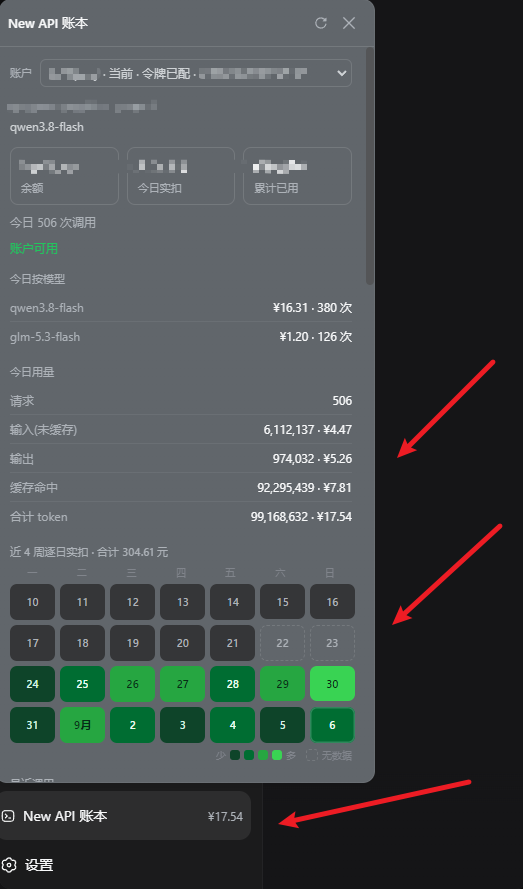

# @loostone/dsh-newapi-wallet

[DeepSeek Harness](https://github.com/deepseek-ai)（DSH）侧边栏的 **New API 网关账本**：显示当前路由在自建 [New API](https://github.com/Calcium-Ion/new-api) 网关上的**今日实际扣费**、按模型拆分（带金额）、输入/输出/缓存分桶金额、**近 4 周逐日消费热力图**与逐条消费明细。

金额**只来自网关账本**，不做本地 `token × 单价` 估算。

## 展示效果

侧边栏底部入口点开即得：余额 / 今日实扣 / 累计、按模型与分桶的 ¥ 金额、近 4 周逐日消费热力图（悬停看单日）、逐条明细。



派生自上游 MIT 项目 `dsh-gateway-wallet`（作者 MuAllen），派生说明与许可见 [NOTICES.txt](NOTICES.txt)，上游 [LICENSE](LICENSE) 全文原样保留。

## 为什么不是本地估算

一条真实调用的输入里通常大部分是**缓存命中**，缓存命中按折价单价计费（本站点为未缓存输入的十分之一），缓存**写入**按另一档单价计费。用 `prompt + completion × 倍率` 直接乘单价会显著高估实际花费（缓存占比越高，偏差越大）。本插件因此只读网关已经算好的 `quota`，再按网关自身声明的换算常数显示为对应币种。

## 功能

- 侧边栏底部一个入口，徽标直接显示**今日实扣金额**
- 点开面板是**左右两列**，各自独立滚动：
  - **左列**：余额 / 今日实扣 / 累计已用三卡 → **近 4 周逐日消费热力图**（颜色深浅 = 当日实扣，格内日号、每月 1 号显示「X月」，悬停弹卡看金额与次数，零消费与「网关没留记录」是两种格子）→ **今日按模型** → **今日按令牌**（两个列表每行带 ¥ 与次数、带占比条；**整行可点选**：点一下筛右列，再点同一行取消）→ **页脚**（网关地址 · 读取时间；截断时写明「今日 N 行，已统计 M 行」）
  - **右列**：**已筛提示条**（显示当前筛了哪个模型 / 令牌，点 ✕ 一键取消；没筛时整条不出现）→ 今日用量分桶（未缓存输入 / 输出 / 缓存命中 / 缓存写入，每行带对应 ¥ 金额，四行之和恒等于今日实扣）→ **最近调用**（只有这个区域内部滚动）
- **左列只负责「选」，自身永不收窄**：两个列表恒为全天口径。否则一点某行，列表自己就塌成 1 行，再也点不回别的分组
- 筛选只作用于右列的「今日用量」与「最近调用」；头部实扣、热力图与左列两个列表恒为全天口径
- **单条调用的展示规则**：恰好两行、每行两格，左格居左右格居右（两行共用 `1fr auto` 两列，右边缘对齐）——
  第一行「`09:22 - 公司 win new` | `deepseek-v4.1-flash ¥0.0249`」，第二行「`input: 194.329K` `output: 1.914K` | `缓存 193.408K · 99.5%`」。
  模型名在金额左侧、比金额暗一档（钱是这张卡唯一的高亮）；网关没给模型字段时只显示金额，不漏 `undefined`。
  input 与 output 并排在第二行左格，不是上下两行：第一列固定 `16ch`（`grid-template-columns:minmax(0,16ch) auto`），
  于是每张卡片的 `output:` 都从同一个 x 开始——这就是制表位的效果，但列宽确定，不吃字体的度量差异。
  命中率 = 缓存读取 ÷ 输入总量（prompt 含缓存读取与缓存写入），三档配色：**≥96% 绿 / 80~96% 黄 / <80% 红**；
  这一笔没有缓存读取时那一格留空（不写「缓存 0」），网关偶发缺用量时数值写 `—` 而不是 0。
  左格过长走省略号，不会把右格挤出去。
- **筛出空集是合法结果，如实显示成全 0**：模型 × 令牌可以一条调用都没有（例如某模型从没用过某个令牌）。
  这时右列「请求 0 / 四桶 0 / 合计 0 · ¥0.00」，左列两个列表照旧全天——不能拿全天数字凑，
  也不能因为「没数据」就把列表藏掉（那会让人以为筛选把界面弄坏了）
- **令牌在「插件」页里配**：侧栏「插件」→ 本插件 → 访问令牌，一个输入框。写入走 DSH 官方 config form（`settings.update`），保存后即时生效、不用重启；令牌是 `role('secret')` 字段，由宿主脱敏，**只写不读、永不回传浏览器**
- **面板里没有任何配置入口**：0.2.2 删掉了供应商卡片与令牌弹窗。面板只剩展示，少一条能写凭据的入口就少一份攻击面
- 令牌是**全站唯一**的：一个 DSH 通常只连一个 New API 网关，原先「按 DSH 路由分别覆盖令牌」的 `routeAccessTokens` 永不命中，已删除
- 按需刷新：只在有会话运行、或面板打开时轮询；空闲且关闭时不发任何请求
- 站点没返回的字段就不显示对应行，并说明原因，不会静默换算成 0

## 全天账本怎么取（性能与截断口径）

一天可能上万行账单（实测昨日 10,470 行 = 105 页 ≈ 9MB）。插件不在每次刷新时重拉全量：

| 时机 | 行为 | 实测开销 |
| --- | --- | --- |
| 当天首次（冷启动） | 先取一页拿 `total`，按总量自适应翻页（并发 12），封顶 **200 页 = 20,000 行** | 10,470 行（105 页）≈ **0.7s** |
| 之后每次刷新 | 补一次全天第 1 页（拿权威总行数），再取 `created_at >= 上次最新` 按 `request_id` 去重追加 | 空闲时**约 1KB** |
| 切换筛选（点左列某行） | 在本地缓存上重算，**不发任何网关请求** | 0 |
| 跨零点 | 缓存按 (origin, 本地日期) 键控，自然失效重建 | — |

- 缓存只存在**宿主进程内存**，不落盘、不含凭据，DSH 重启即消失。
- 扫描上限必须覆盖真实峰值：本网关单日 10,470 行是常态，早期 3000 行的上限让每天下午都截断，
  于是头部「今日实扣」（全天 `stat`）与「今日用量 / 按模型 / 合计」（本地账本）恒差一截，
  看起来像算错。现在上限 20,000 行，真超了才截断。
- 截断时页脚写明「今日 N 行，已统计 M 行」，其中 N 是**服务端**当日总行数（不是本地缓存行数），
  对比得出漏了多少——**明确标注截断，不静默失真**。
- 并发 6 是瓶颈而非网关：同一次 105 页拉取，并发 6 要 8.9s，并发 12 只要 0.7s。
- 实测依据：账本行一旦出现即不再改写（8 次采样 11 行，0 次变动）→ 增量累加安全；`request_id` 全 1,750 行唯一且非空 → 可作去重主键（行内 `id` 字段会随查询窗口重置成 1，**不能**当主键）。

## 安装

开源仓库，**全部写法都不需要 SSH 密钥或登录**（下面每条都在禁用 SSH 的环境里实测通过）：

```sh
# GitHub（推荐）：pnpm 会规范化为 hosted 规格，直接下载匿名 HTTPS tarball 并按 commit SHA 锁定
dsh plugin --profile web add "github:lzd-loostone/dsh-newapi-wallet#v0.2.4"

# 等价的显式 HTTPS git 地址（效果同上，锁文件里仍会记成 hosted 规格）
dsh plugin --profile web add "https://github.com/lzd-loostone/dsh-newapi-wallet.git#v0.2.4"

# 也可以直接给归档 tarball 地址
dsh plugin --profile web add "https://codeload.github.com/lzd-loostone/dsh-newapi-wallet/tar.gz/refs/tags/v0.2.4"

# 或从内部 npm registry
dsh plugin --profile web add @loostone/dsh-newapi-wallet@0.2.4

# 或分发本地 tarball 文件
dsh plugin --profile web add <路径>\loostone-dsh-newapi-wallet-0.2.4.tgz
```

- **请钉 tag 或 commit**（`#v0.2.4`），不要写 `#main`/`#master`：pnpm 会把 tag 解析成具体 commit 并把 `codeload` 的 SHA 地址写进 `pnpm-lock.yaml`，同事之间装到的字节完全一致。
- 预构建产物 `lib/` 已入库，所以**安装不触发任何构建脚本**，也不会被 pnpm 的构建脚本策略拦截。
- 零运行时依赖。
- 用本地 `.tgz` 安装时注意：pnpm 会把它记成 `file:` 依赖，**装完那个文件不能删也不能挪**，否则以后每次 `dsh plugin` / `pnpm install` 都会因解析不到路径而失败。上面的 URL 方式无此约束。
- 装完或卸载后**需要重启 DSH**：bundle 只在启动时挂载，只刷新页面会因为 client roster 过期而白屏。

卸载：

```sh
dsh plugin --profile web remove @loostone/dsh-newapi-wallet
```

本插件不写任何私有数据文件；令牌通过宿主设置服务存储（见下），卸载后那条配置行可在设置界面或手工删除。

## 配置

**在哪里填**：侧栏 **「插件」** → 找到本插件 → 打开它，页面上有一个「访问令牌」输入框和一个「保存」按钮。

令牌取自 New API 网页端 **个人设置 → 访问令牌** 生成的那一串（**不是** `sk-` 开头的模型调用密钥）。

**怎么写的**：走 DSH 官方 config form（`form.mutate` → `settings.update`），保存后**即时生效、不用重启**。值落在当前 profile 的 `cordis.patch.yml` 里本插件条目的 `config` 下：

```yaml
- id: loostone-newapi-wallet
  name: '@loostone/dsh-newapi-wallet'
  config:
    accessToken: '<New API 访问令牌>'
    refreshMs: 60000        # 可选：自动刷新间隔，实际夹在 [10s, 10min]
```

**安全约定**：

- `accessToken` 声明为 `role('secret')`，宿主在把配置下发给浏览器前会**摘掉它的值**，只保留「是否已配置」这个事实。所以输入框**只写不读**，保存后不会回显，这是设计而不是缺陷。
- 令牌以**明文**存在上面那个 yml 里，请按密码对待：不要提交到仓库、不要贴进聊天或工单。
- 未配置令牌时面板会提示「还没配 New API 访问令牌」并告诉你去哪里填，而不是显示 0 假装正常。

网关地址与模型调用密钥仍来自 DSH 原有的 LLM 路由配置，本插件不复制一份、也不写回。

## 计费口径

不同 New API 实例的换算常数不一样，所以**运行时从网关 `/api/status` 读取**，不写死：

```
显示金额 = quota / quota_per_unit × usd_exchange_rate      （币种取 quota_display_type）
quota    = 该行计费表达式的结果 × quota_per_unit / 1e6
```

面板上的每一笔金额都来自网关已经记账的 `quota`。分桶金额（未缓存输入 / 输出 / 缓存命中 / 缓存写入）的口径：`/api/log/self` 的每条账单在 `other` 里**自带这笔的计费表达式** `expr_b64`，解出来形如

```
tier("base", p * 0.15 + c * 0.5625 + cr * 0.015 + cc * 0.1875)
```

其中 `p` = 未缓存输入、`c` = 输出、`cr` = 缓存命中、`cc` = 缓存写入。用解出的四个单价算分量权重，再按该行真实 `quota` 等比回缩——权重是真的，四桶之和恒等于账本金额。**不请求价目接口，也不做本地估价。**

token 桶同源：`prompt_tokens` 里可能同时含缓存命中与缓存写入，两者都扣掉后才是真正的「未缓存输入」。四桶之和恒等于「合计 token」。

> ⚠️ 改取数逻辑时注意：网关的计费方式换过一次。旧版按 `other.model_ratio` / `completion_ratio` / `cache_ratio` 拆分，**这三个字段在表达式计费下恒为 0**——照旧写法拆，分量权重全为 0，整笔金额会塌进「输入」一行，输出与缓存恒显 ¥0.00，且 `cache_creation_tokens` 整桶丢失。`src/snapshot.ts` 的 `parsePrice()` 解表达式；解不出时自动退回旧比例口径，不会算错总数。`test/harness.mjs` 里有五条断言盯死这四种病征。

## 使用的接口

| 接口 | 凭据 | 用途 |
| --- | --- | --- |
| `/api/status` | 匿名 | 读取换算常数与站点信息；同时是唯一的网关类型探针 |
| `/api/user/self` | 访问令牌 | 账户、余额、累计用量 |
| `/api/log/self/stat` | 访问令牌 | 今日实扣；热力图「今天」格与 data/self 缺口日的逐日补探 |
| `/api/data/self` | 访问令牌 | 近 4 周逐日金额（小时行按本地日期聚合）；账本不可用时兜底今日合计 |
| `/api/log/self` | 访问令牌 | 逐条消费明细；输入/输出/缓存命中/缓存写入分桶金额与 per-model 聚合（全天分页聚合） |

网关类型识别只靠匿名 `/api/status`：New API 会正常返回站点信息，其他中转站不会。探测结果按 origin 缓存。账本读的是**当前默认路由所在的那个网关**；非 New API 的路由会被滤掉（若一条都没探出来，错误信息会列出每条路由的失败原因）。本插件不调用任何 token 级接口，因此不受那类接口限流影响。

## 开发

```sh
npm i --no-save --prefix .build-deps esbuild
node scripts/build.mjs        # 生成 lib/index.js 与 lib/client.js(+map)
DSH_TEST_TOKEN=<访问令牌> DSH_TEST_ORIGIN=<网关地址> node test/harness.mjs
```

`test/harness.mjs` 不启动 DSH：用最小假 Cordis 上下文加载构建产物，走完「`settings.describe()` 读路由 → 探出 New API → 取令牌 → 请求网关 → 回环路由出账本 / 写令牌」全链路，并断言响应体不含任何凭据。它需要两个环境变量，仓库里不含任何真实地址或密钥。

接口上有两个实测坑（代码里已带防线，改取数逻辑时别退回）：`/api/log/self` 的翻页参数是 **`p`**——这个 fork 会**静默无视 `page`** 并反复返回第一页（曾把全天聚合放大 10 倍）；`/api/data/self` 的窗口上限是一个月（30 天），热力图取 28 天恰好覆盖。

构建上有两处不能图省事：`@deepseek-ai/schemastery` 与其依赖必须**内联**进宿主半（宿主环境不提供）；前端 bundle 的 `__ModuleLoader__` id 必须等于**包名**。`scripts/build.mjs` 已经处理好，别退回上游的 `--external:@deepseek-ai/*`。

客户端半刻意**不 import 任何 Harness Client 包**（图标与「点面板外面收起」都是自实现），所以 `dsh.client.inject` 是空数组：那里填的是「本 bundle 运行时会 `require` 的裸模块名」，不是「用到的契约包」。产物只 require `react` 与 `react/jsx-runtime`。

## 排错

- **面板说找不到 New API 站点**：候选来自「DSH 已配置的模型路由」∩「匿名探测出是 New API 的站点」。路由没配 `baseURL`，或站点没有可用的 `/api/status`，都会被滤掉；错误信息会列出被滤掉的路由和原因。
- **「插件」页里找不到本插件**：它只列出注册了配置页的插件。确认装的是 0.2.2 及以上（更早的版本没有配置页，令牌只能在面板卡片里填）。
- **面板报 `forbidden`**：本插件的只读路由只接受来自本机的请求。若你的 DSH 后端不是跑在本机，需要改走宿主 RPC。
- **改了 `dsh.client.inject` 或装卸插件后前端无变化**：需要重启 DSH（见上）。
- **金额与站点不一致**：先核对 `/api/status` 的 `quota_per_unit` / `usd_exchange_rate` / `quota_display_type` 是否被本插件读到；读不到时面板会说明而不是猜。
- **面板显示 forbidden**：本插件的路由只接受来自本机的请求。若你的 DSH 后端不是跑在本机，需要改走宿主 RPC。

## 已知限制

- 只统计经过网关的模型调用；网关未记账的请求不在内。金额以网关账本为准，不构成对账凭证。
- 访问令牌是用户级的：看到的是该令牌所属账户的花费，不是整组总额（需要组总额请用管理账户的令牌）。
- 逐条明细与 DSH 本地消息目前按时间 + 模型对应，尚未与 `request_id` 严格绑定。
- 热力图的逐日数据以网关统计表的保留范围为准：超出覆盖的天显示「无数据」（虚线格），与「零消费」（浅灰格）严格区分，不会混为一谈。
- 账本只显示**当前默认路由**所在网关的数字；同一个网关上的多条模型路由看到的是同一份账本。
- New API 若改版接口字段，对应行留空并说明原因，不会静默换算。

## 许可与免责声明

MIT。上游 `dsh-gateway-wallet` 的 MIT 许可与版权声明完整保留于 [LICENSE](LICENSE)。

本软件按「现状」提供，与 DeepSeek、New API 及各中转服务无隶属或背书关系，作者不对使用本插件造成的损失承担责任。
